# ASE AE2 Project Report
# UI5 Academy

Link to Figma Prototype: https://www.figma.com/design/Z9Y4hLkBBwe6Fgt9GoJdgJ/Untitled?node-id=16-317&t=dzqVtsQOoHp23uiH-1 
Link to Application: https://lillyuni.github.io/UI5-Academy/ 
Link to GitHub Repository: https://github.com/lillyUni/UI5-Academy

## 1.	Background
### 1.1 Project overview 
This project establishes the foundation for a learning application designed to introduce colleagues to the core principles of SAP UI5. The Minimum Viable Product (MVP) provides users with introductory learning content covering the fundamental concepts and structure of SAP UI5 development. It also incorporates an interactive Knowledge Test through which users can assess their understanding and receive a score based on their responses.

### 1.2 Organisational Problem 
The portfolio has delivered SAP UI5 development services to the client for approximately eight years, and demand within this area continues to grow. Despite this growth, the existing SAP UI5 team has limited development capacity, consisting of two contracted developers, and two developers temporarily supporting the team creating several operational challenges.

This resourcing challenge is likely to become increasingly significant as SAP UI5 becomes more strategically important within the future S/4HANA technology landscape. Increasing the number of developers with relevant UI5 capability is therefore important to supporting the continued growth of the team. However, SAP UI5 represents a relatively specialised technical skillset, making the recruitment of suitably experienced developers challenging. 

### 1.3 Product aim and objectives 
The aim of this project is to design and develop the initial phase of an SAP UI5 learning application that enables users with no previous UI5 experience to develop foundational knowledge and assess their understanding. 

This aim is supported by the following objectives:
-	To introduce users to the fundamental concepts of SAP UI5.
-	To develop users' understanding of the typical folder and file structure of an SAP UI5 project.
-	To provide an interactive Knowledge Test that enables users to assess their understanding.
-	To establish an extensible foundation capable of supporting future iterations.

### 1.4 Users and requirements 
The primary target audience for the application is individuals with limited knowledge of SAP UI5, particularly graduates who may also have limited professional experience. A secondary audience consists of more experienced software developers seeking to expand their existing technical capabilities. The MVP must therefore provide introductory material for inexperienced users while remaining relevant to developers transitioning from other technologies.

The following requirements have been identified:
-	The application must be developed with consideration of WCAG 2.1 accessibility requirements.
-	The application must provide clear, beginner-friendly learning content.
-	The application must provide relevant and usable introductory information about SAP UI5.
-	The application must enable users to assess their knowledge.

### 1.5 Scope of the MVP 
To establish a realistic scope for the MVP, the project requirements were prioritised using the MoSCoW prioritisation technique. 

Must Have
An introduction to SAP UI5.
-	An introduction to the principal folders and files within an SAP UI5 project.
-	Clear and intuitive application navigation.
-	An interactive Knowledge Test.
-	A score following completion of the Knowledge Test.

Should Have
-	A selection of external learning and training resources.
-	Visual feedback on answers.

Could Have
-	An introduction to accessibility within software development.
-	A structured project or learning pathway for users to complete.
-	Individual section Knowledge Tests.

Won't Have
-	Client-specific information, due to security and confidentiality considerations.
-	User authentication or individual accounts.
-	Persistent storage of previous Knowledge Test scores.

## 2.	Design and User Research
### 2.1 UX Research and Mood Board 

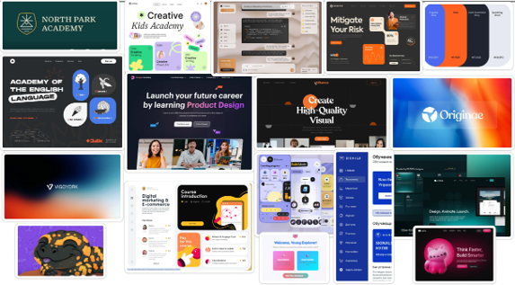
*Figure 1: Mood board*

To inform the visual direction of the application, initial UX research was undertaken through the creation of a mood board using Dribbble and Figma. 

The research demonstrated how different typographic styles could influence the perceived character of a learning platform. More conventional typography can create a professional and structured appearance, whereas more playful styles can contribute to a less formal and potentially more engaging learning environment. 

Colour was explored in a similar manner, with both light and dark interfaces considered during the research process. Blue and white were selected to maintain a visual connection with established corporate identity, while orange was introduced as an additional accent colour to provide a distinguishable visual identity. The darker background was subsequently used to create a more contemporary visual style while allowing the brighter accent colours to provide contrast.

### 2.2 User Personas
2. 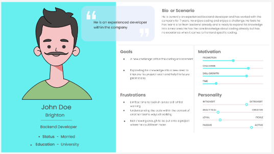 
3. 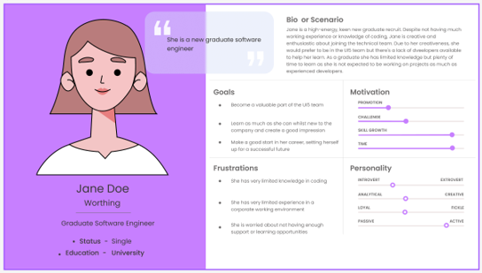
4. 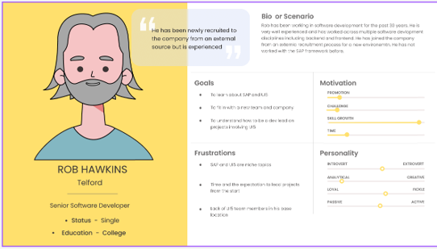	 
*Figures 2 -4: User Personas from UX Research.*

To ensure that the design responded to realistic user needs, three personas were developed to represent the principal audiences identified for the application. 

John represents an established colleague and senior developer who is interested in developing additional technical capabilities. His existing project responsibilities, however, mean that the time available for structured learning is limited. This creates a requirement for learning content that can be accessed independently and divided into concise sections that can be resumed without requiring continuous periods of study. Working within a specialised environment means that future iterations of the learning application would need to provide  appropriate organisational context and established team practices.

Jane represents a newly recruited graduate who is motivated to develop a career within SAP UI5 but has limited experience of professional software engineering. Consequently, Jane requires learning material that introduces concepts progressively and avoids unnecessary assumptions regarding existing technical knowledge. Limited capacity within the existing UI5 team could restrict the amount of direct support available. The application must therefore enable Jane to learn independently. 

Rob represents an experienced software developer who has recently joined the organisation. Rob's principal requirement is to develop sufficient knowledge to contribute effectively to UI5-based projects. However, similarly to John, project commitments may restrict the amount of time available for formal learning. Geographic separation from other team members may also reduce opportunities for informal face-to-face knowledge transfer. 

Collectively, the personas identified several recurring user requirements. The application needs to:
-	support independent learning;
-	assume limited or no previous SAP UI5 knowledge;
-	present information in clearly structured sections;
-	accommodate users with differing levels of wider software engineering experience;
-	minimise reliance on existing UI5 developers
-	provide an extensible foundation through which more contextual and advanced learning content could be introduced in future iterations.

### 2.3 Design Decisions and Prototype
Following the initial UX research and development of the user personas, the findings were translated into a series of design decisions covering colour, accessibility, navigation, information architecture and visual presentation.

5. 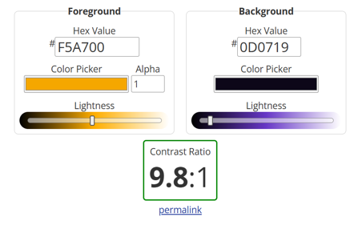
6. 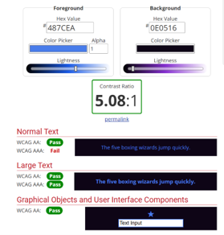	 
7. 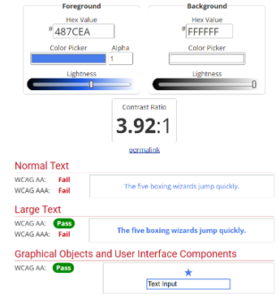	 
*Figures 5 -7: Colour contrast check results*

Colour selection was refined by evaluating combinations from the proposed palette against WCAG contrast criteria. One tested combination produced a contrast ratio of 3.92:1 when blue was displayed against white. This combination was therefore not selected for standard body text. Instead, its intended use was restricted to appropriate user-interface and visual elements, while higher-contrast combinations were selected for textual information. 
The initial interface was first explored through a low-fidelity paper concept. This provided a rapid method of translating the findings from the organisational problem, project requirements and user personas into an initial structure before committing to a detailed digital prototype. 

8. 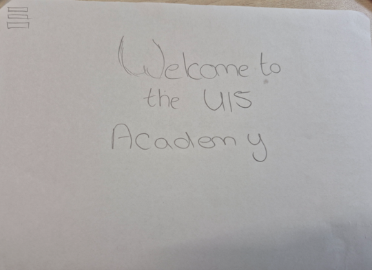	 
9. 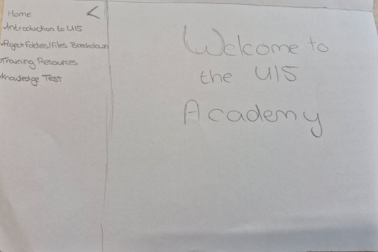 
10. 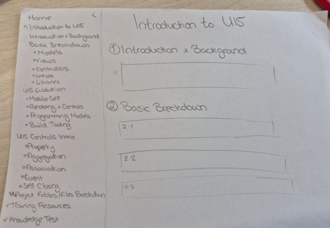	 
11. 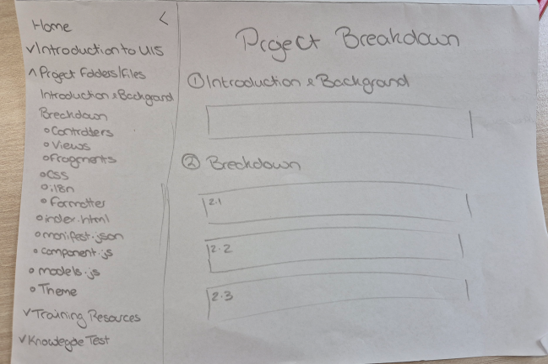	 
12. 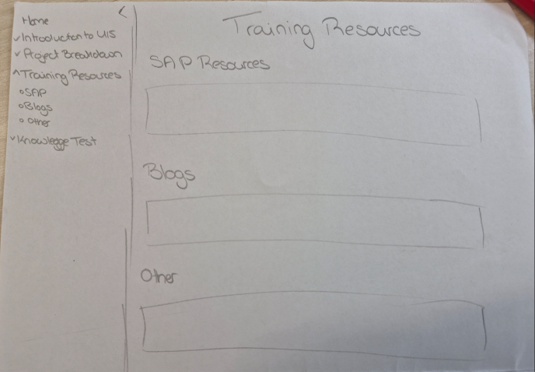	 
13. 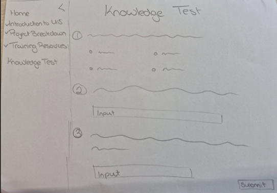
*Figures 8 -13: Initial paper design concept art*

The concept was subsequently developed into a higher-fidelity prototype using Figma. The resulting prototype consisted of five principal screens connected through a menu, alongside a popup for presenting Knowledge Test results. The navigation was designed to provide access both to different areas of the application and, where appropriate, specific content within those areas.

14. 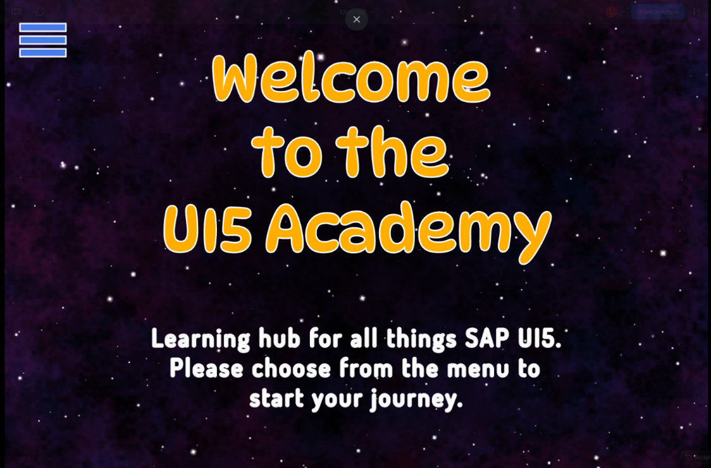	 
15. 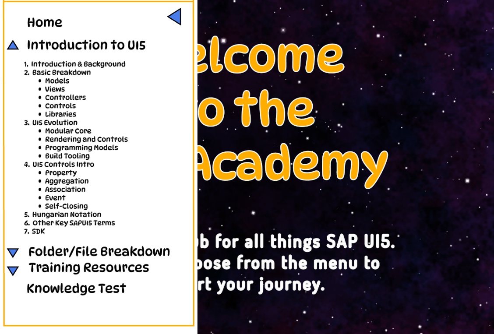	 
16. 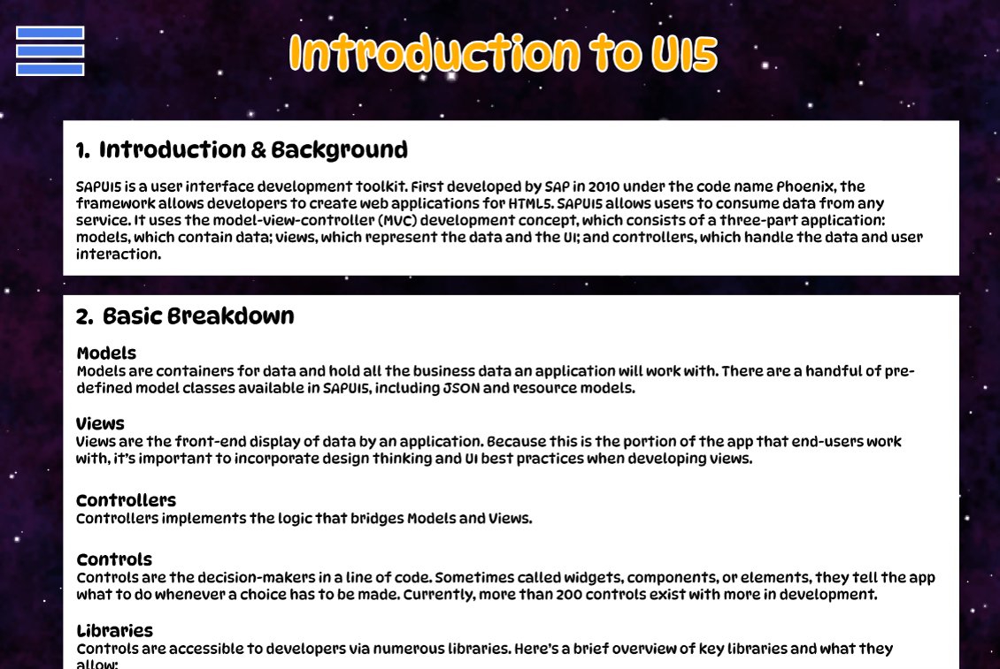	 
17. 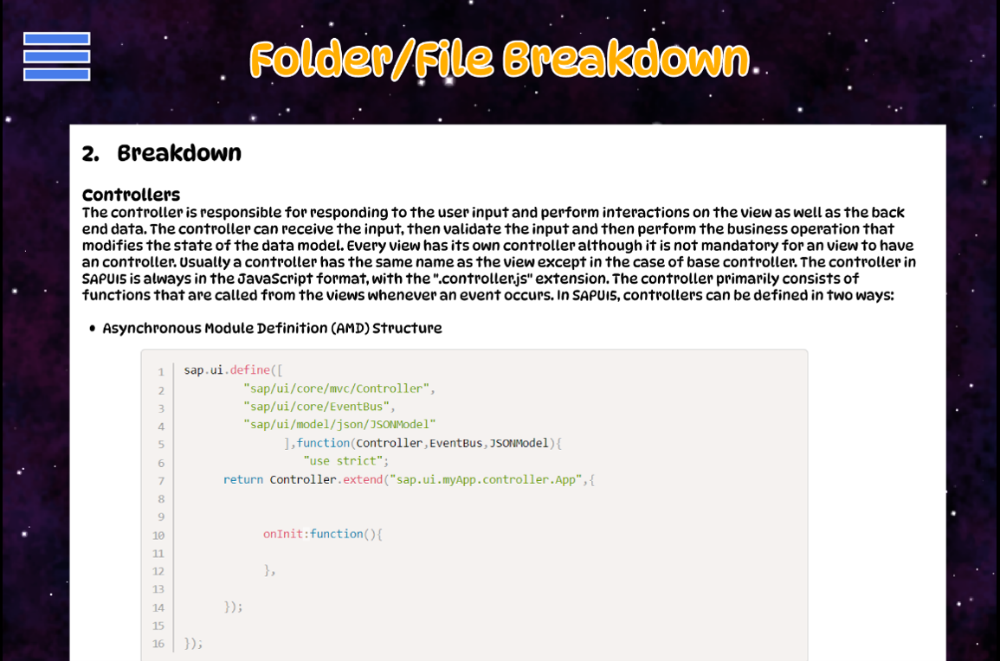	 
18. 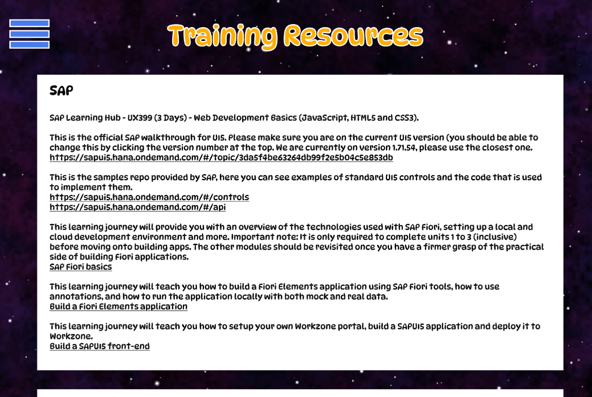	 
19. 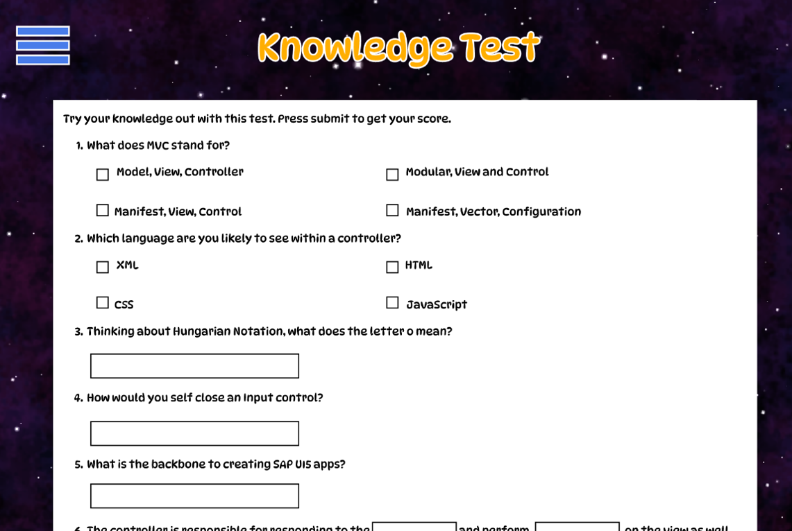	 
20. 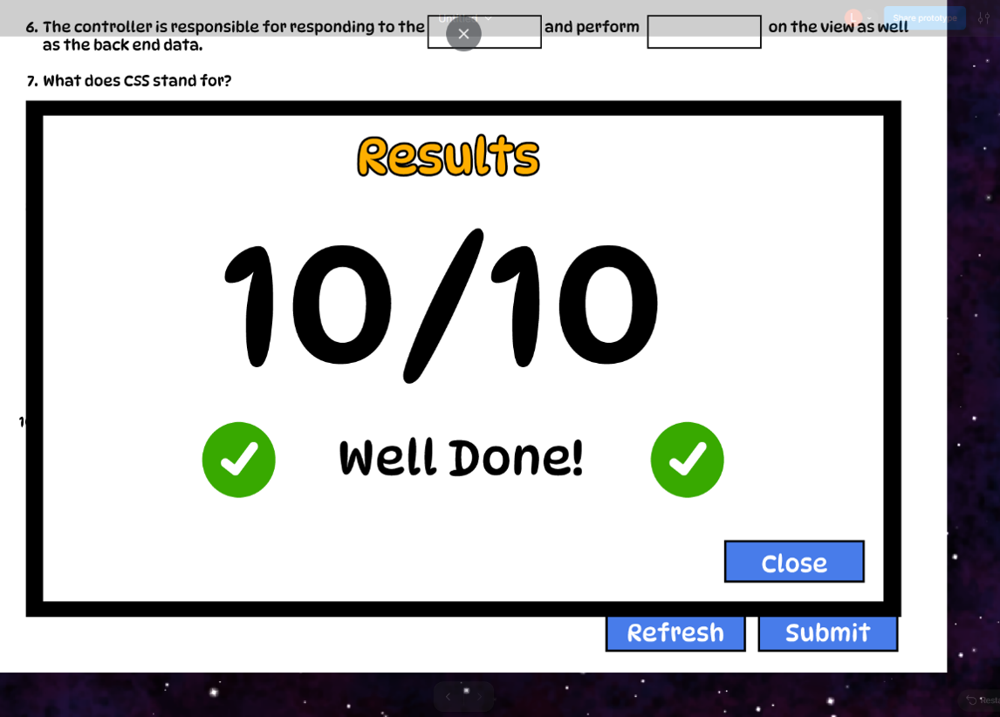	 
*Figures 14 -20: Prototype screenshots from Figma.* 

The visual style was intentionally designed to distinguish the learning application from a conventional corporate information resource. The DynaPuff typeface was explored as a means of establishing a more informal and approachable identity for the Academy.

Overall, the final prototype translated the research findings into an interface designed to provide accessible, independent and beginner-friendly access to introductory SAP UI5 information. 

## 3.	GitHub
### 3.1 GitHub Projects
To support the structured management of the MVP development lifecycle, GitHub Projects was used to establish a Kanban-style project board. This provided a centralised method of recording, prioritising and monitoring development activities throughout the project.

The initial project board contained three workflow stages: To Do, In Development and Complete. To more accurately represent the software development lifecycle, an additional Test stage was introduced. Design-related tickets were also created during the early stages of the project to represent discovery and design activities.

Throughout development, tickets were moved between workflow stages to provide a visual representation of project progress and outstanding work. The number of tickets simultaneously progressing through the In Development and Test stages was intentionally limited where possible. This approach was used to reduce excessive work in progress and maintain focus on completing existing activities before beginning additional work.

Additional tickets were created when new requirements, enhancements or defects were identified, resulting in a total of 30 tickets by the conclusion of the MVP development cycle. To support traceability across the increasing number of work items, each ticket was provided with an appropriate title and description, an assigned developer and descriptive labels to enable tasks to be identified quickly. Where relevant, supporting images were attached and associated branches or pull requests were linked to the corresponding ticket. Figures 21–26 demonstrate the evolution of the GitHub Projects board across different stages of the development lifecycle. 

21. 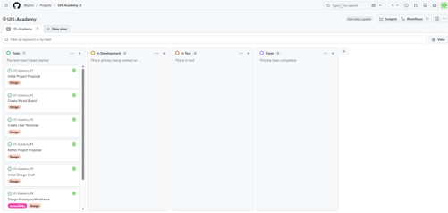	 
22. 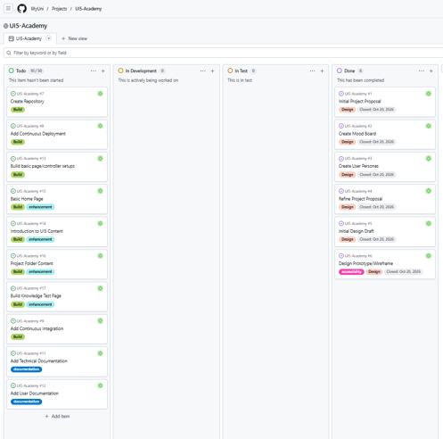	 
23. 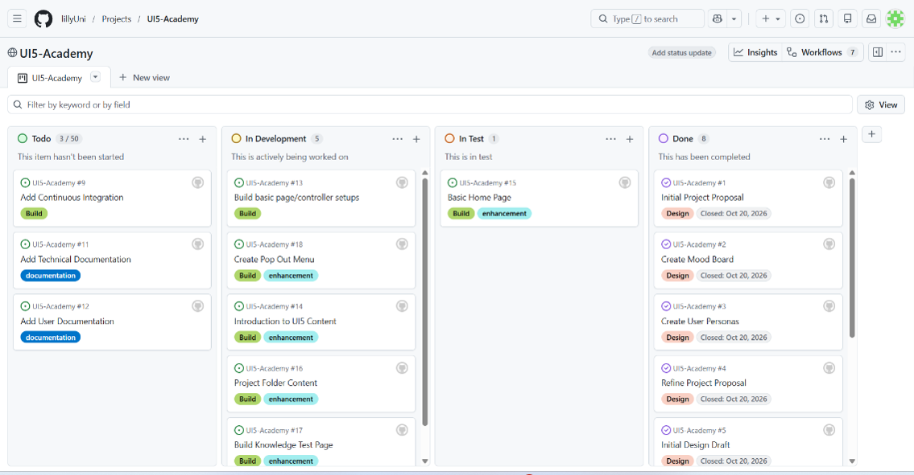	 
24. 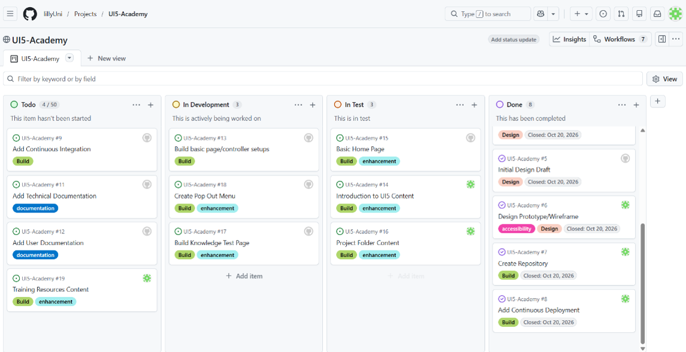	 
25. 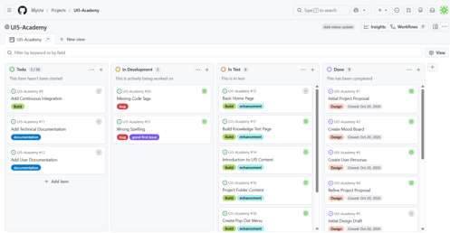	 
26. 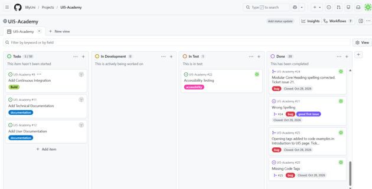	 
*Figures 21 -26: Example screenshots of GitHub Projects throughout development.*

### 3.2 GitHub Issues, branches and pull requests 
The project repository was initially established with a main branch, which was used to create the application's HTML boilerplate using Emmet within Visual Studio Code. Once this initial project foundation had been established, subsequent development was separated from main through the creation of dedicated development branches. 

The Initial-Dev branch was used as the principal development branch and acted as the base for additional feature and defect-specific branches. Maintaining this separation reduced the risk of incomplete or untested changes being introduced directly into main. Changes were instead incorporated through pull requests and controlled merges, providing a more structured approach to reviewing and integrating completed development work.

The branching strategy was closely integrated with the GitHub Projects workflow described previously. Individual work items, including features and defects identified during testing, were recorded as tickets. Figure 27 demonstrates this traceability through the development of the Knowledge Test, showing how an individual requirement was documented and progressed through the stages of the project workflow.

Where development required an isolated change, such as the resolution of a defect, a dedicated branch was created from Initial-Dev. Development and testing could therefore occur independently without affecting either the stable main branch or unrelated areas of ongoing work. This reduced the likelihood of incomplete development work being deployed unintentionally. 

Figures 28 and 29 present the repository network graph at the conclusion of the MVP development cycle, illustrating the relationship between the branches created throughout development. 

27. 	 
28. 	 
29. 	 
*Figures 27 -29: Screenshots demonstrating an issues, the network graph and the branches.*

### 3.3	CI/CD Pipeline
A Continuous Integration and Continuous Deployment (CI/CD) approach was introduced to automate both the deployment and testing of the MVP. Following the initial boilerplate commit to the main branch, GitHub Pages was configured to provide continuous deployment of the application. As a result, changes integrated into main, including those introduced through completed pull requests, could trigger the deployment workflow and update the published version of the application.

Later in the development lifecycle, automated testing was incorporated following the introduction of Jest. A continuous integration workflow was configured through GitHub Actions to execute the automated test suite when changes were made to main. The resulting CI/CD process therefore combined two complementary workflows: continuous integration through automated Jest testing and continuous deployment through GitHub Pages. 

30. 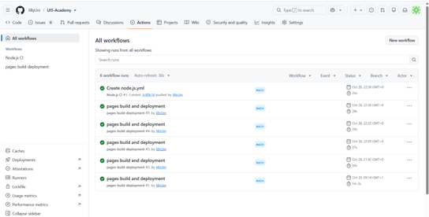	 
31. 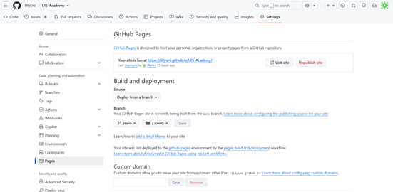	 
*Figures 30 -31: Demonstration of the CI/CD Pipeline.*

## 4.	MVP Development, Testing & Technical documentation  
### 4.1 Folder/File Structure
The application architecture was designed using a structured folder hierarchy inspired by SAP UI5 development. Resources were organised according to their purpose, with views, controller logic, reusable components, images and CSS maintained within separate directories. This provided a clear and predictable project structure while making individual resources easier to locate during development in Visual Studio Code.

Where appropriate, the project adopted a relationship between individual views and their associated controller logic. This approach can be seen within the Knowledge Test functionality, where the interface is contained within its corresponding view and the behaviour maintained within a dedicated JavaScript controller. 

Functionality with the potential to be shared across multiple areas of the application was separated into a dedicated reusable directory. Incorporating reusable components reduces unnecessary duplication and provides a single location from which common functionality can be maintained. The popup navigation menu is currently defined individually across multiple HTML files; in a future iteration, this could be refactored into a reusable component, allowing central changes to the navigation structure.

Overall, the resulting folder and file structure balances conventions drawn from SAP UI5 development with the comparatively lightweight requirements of the MVP. 

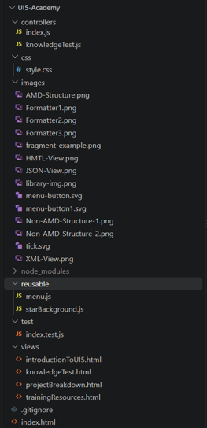
Figure 32: Folder/File Structure of the project.*

### 4.2 Key MVP Development and Technical Documentation
Development of the MVP was approached incrementally, with functionality implemented on a page-by-page basis. This allowed the underlying HTML, CSS and JavaScript techniques to be established progressively before being applied to more interactive areas of the application.

The initial welcome page was developed within index.html, which currently acts as both the application's entry point and the first user-facing screen. Reflecting on this implementation, a future architectural improvement would be to separate these responsibilities, providing clearer separation between application initialisation and presentation as the project expands.

The first implementation objective was to establish the structure and visual layout of the home page. This stage involved developing an understanding of element positioning, custom font integration and the interaction between HTML structure and CSS styling. 

An animated star-themed background was also investigated during development. However, the generated <pre> &lt; div &gt;</pre> elements used to produce the effect interfered with the positioning of other interface elements. As the star background represented a decorative enhancement rather than functionality, further development was deprioritised. The feature could subsequently be reconsidered within a future iteration.

Development subsequently progressed to the sidebar navigation menu. A custom SVG hamburger-menu icon was produced using Inkscape and implemented as an interactive image with alternative text to support accessibility. The navigation functionality is distributed between HTML, CSS and JavaScript. CSS classes control the visual presentation and transition behaviour of the sidebar, while JavaScript contained within menu.js controls the opening and closing interactions. 

Expandable navigation sections were implemented using the semantic HTML <pre> &lt;details&gt;</pre> and <pre> &lt;summary&gt; </pre> elements. Each <pre> &lt;details &gt;</pre> element groups the navigation options associated with a principal learning section, while <pre> &lt;summary&gt; </pre> defines the visible section heading. Links contained within each group provide access to the corresponding page or specific content. CSS is additionally used to provide visual feedback when sections are expanded or collapsed.
The navigation menu is currently repeated within each HTML page rather than being implemented as a single reusable component. Although sufficient for the scope of the MVP, this introduces duplication and represents an area for future refactoring. 

The Introduction to UI5, Project Folder Breakdown, and Training Resources pages primarily consist of static learning content and therefore do not require dedicated JavaScript controller logic. Each uses a consistent structural approach incorporating the navigation interface alongside page-specific learning content.

Content is divided into visually distinct sections using <pre> &lt;div&gt; </pre> elements and appropriate CSS classes. Heading levels are used to communicate the hierarchy of information, with <pre> &lt; h2 &gt; </pre> elements representing principal sections, <pre> &lt;h3&gt; </pre> elements identifying subsections and <pre> &lt;p&gt; </pre> elements containing supporting textual content. Images are incorporated where appropriate with alternative text to improve accessibility. 

The Knowledge Test represented the most interactive component of the MVP. It incorporates user inputs and dedicated JavaScript functionality through knowledgeTest.js.

The controller contains three principal functions:
-	onRefreshQuiz() - Resets the Knowledge Test by clearing text inputs and changing the selected state of multiple-choice inputs to false.
-	onSubmit() -Evaluates each of the ten user responses against the accepted answers, increments the score for each correct response, displays the resulting score out of ten and opens the results popup.
-	closePopup() - Removes the CSS class responsible for displaying the results popup.

A representative extract from this implementation is provided in Figure 34.

The Knowledge Test logic was additionally supported through Test-Driven Development, with nine Jest tests covering its principal behaviours. The automated testing strategy of the TDD process are discussed further in Section 5.4.

Several development dependencies are required to support the current development and automated testing environment:
-	Jest, providing the automated JavaScript testing framework.
-	jest-environment-jsdom, providing a simulated DOM environment for testing functionality that interacts with HTML elements.
-	@jest/globals, used within the ES-module test configuration to access required Jest functionality.
These dependencies support the current implementation and should be installed before executing the automated test suite.

To continue development of the application, the repository and its dependencies must first be configured locally:
-	Clone the repository: git clone https://github.com/lillyUni/UI5-Academy.git
-	Navigate into the cloned project directory.
-	Check out the branch required for the intended development activity.
-	Install the dependencies defined for the project: npm install
-	The application can then be launched locally using the Live Server functionality within Visual Studio Code.
-	The automated test suite can be executed using: npm test

33. 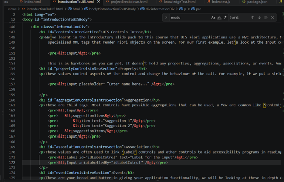	 
34. 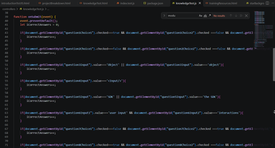	 
*Figures 33 -34: Example code snippets*

### 4.3 Use of Test-Driven Development 
Test-Driven Development (TDD) was used to support the development and verification of the quiz functionality. The quiz contained three main behaviours: resetting the user's answers, evaluating submitted answers and displaying a score, and closing the score popup. 

A suite of nine unit tests was created using Jest, with jsdom used to simulate the browser Document Object Model (DOM). This was necessary because the quiz logic interacts directly with HTML elements through methods such as document.getElementById(). The tests were divided according to the three JavaScript functions. For the refresh functionality, tests verified that previously selected checkbox answers were unchecked and that text-input answers were cleared. 

The submission functionality required more extensive testing because it contained the main scoring logic. Tests were developed for a completely correct quiz, a completely incorrect quiz and a partially correct quiz, producing expected scores of 10/10, 0/10 and 3/10 respectively. An additional edge-case test selected both a correct and incorrect option for a question and confirmed that a point was not awarded. 

A Jest mock function, jest.fn(), was used to confirm that event.preventDefault() was called, ensuring that the quiz prevented the form's default submission behaviour. Another test verified that submitting the quiz added the appropriate CSS class to display the score popup. Finally, a test for the close functionality confirmed that this class was removed when the popup was closed. Collectively, these tests therefore considered not only computational correctness, but also the interaction between the JavaScript logic and the user interface.

The testing process also highlighted practical challenges associated with establishing an automated testing environment. The first issue occurred because the Jest environment could not locate jest-environment-jsdom. As the application depended upon browser DOM functionality, a DOM simulation environment was required for the tests. Installing jest-environment-jsdom resolved this issue and allowed Jest to create the simulated HTML elements required by the test suite. 

35. 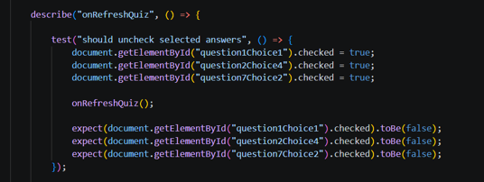	 
36. 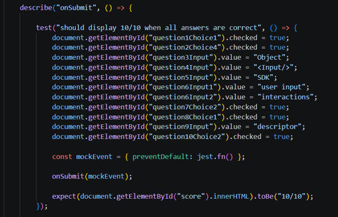	 
37. 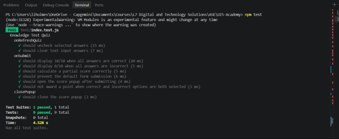	 
*Figures 35 -37: TDD Code snippets and results*

### 4.4 Usability Testing
During development, individual features were manually tested as they were introduced, enabling defects and usability issues to be identified and resolved incrementally. Browser Developer Tools were particularly valuable during this process, supporting the investigation of unexpected behaviour.

Whereas the Jest test suite verified specific behaviours within the Knowledge Test logic, manual testing enabled the application to be considered from a broader user perspective, including navigation, presentation and interaction between pages.

Following integration of the main development work into the deployment branch, a complete usability check was performed. At this stage, the application was approached from the perspective of an end user. Where functionality satisfied its expected behaviour, the corresponding user acceptance criteria could be completed within the GitHub Projects workflow. Where problems were identified, additional defect tickets were created to record and manage the required corrective work.

This stage identified three defects. Two related to minor presentation issues. The third defect was more significant and resulted from a difference between the local development and deployed environments. Navigation that functioned correctly when the application was executed locally through Visual Studio Code Live Server did not behave as expected following deployment. Investigation identified a difference in how the deployed URL resolved the file paths used by navigation links. The issue was corrected by removing the leading forward slash from the affected menu navigation paths.

Although the application had behaved correctly within the local development environment, this did not guarantee identical behaviour following deployment. Testing the deployed build therefore provided an additional level of validation that could not be achieved through local testing alone. 

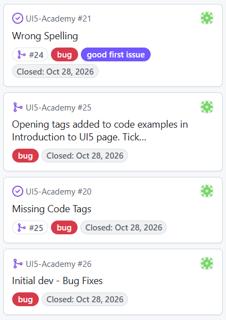
*Figure 38: Example of bug tickets*

### 4.5 Accessibility Evaluation 
During the design phase, colour combinations were evaluated against accessibility contrast requirements to reduce the likelihood of textual and interface elements becoming difficult to distinguish. 

Following deployment, additional accessibility testing was conducted using Lighthouse within browser Developer Tools. The audit identified several areas for improvement across the application, including the association of labels with inputs within the Knowledge Test and the implementation of appropriate page landmarks. These findings demonstrated that, although accessibility had informed the initial design, further consideration was required within the underlying HTML structure to improve the accessibility of the implemented interface.

Manual keyboard testing was also undertaken to determine whether users could navigate the application. The majority of interactive elements could be reached through keyboard navigation and displayed a visible focus indicator. However, testing identified limitations within the sidebar navigation.

Although focus could move through elements associated with the navigation, the menu itself could not be reliably opened using the keyboard. Investigation suggested that the current implementation of the menu trigger, which uses an image as the interactive element, required improvement. A future iteration should therefore restructure this control using an appropriate semantic <pre> &lt;button&gt; </pre> element.

Focus indicators were also identified as an area for refinement. While focus styling was present across much of the interface, the button focus states could be made more visually distinctive to ensure that keyboard users can consistently identify their current position within the interface.

The development process also highlighted differences between working with SAP UI5 and developing directly with vanilla HTML and JavaScript. Framework-provided accessibility behaviour cannot automatically be assumed when developing controls using native web technologies. 

Overall, the accessibility evaluation demonstrated that the MVP incorporates several positive accessibility considerations, including contrast evaluation, alternative text, keyboard focus states and the use of semantic HTML. However, testing also identified unresolved issues surrounding input labelling, page landmarks, focus presentation and keyboard operation of the navigation menu.

The current prototype should therefore not be described as fully accessible at this stage. Instead, these findings provide a prioritised set of improvements for a subsequent iteration. 

39.  	 
40.  	 
41.  	 
42.  	 
43.  	 
44.  	 
45.  	 
*Figures 39 -45: Accessibility testing results*

## 5.	User documentation 
The UI5 Academy has been designed to provide an accessible introduction to SAP UI5 for users with differing levels of previous software engineering experience. The application can be accessed through the deployed version below:
Access the UI5 Academy

Home Page - Provides the initial entry point to the UI5 Academy. To access the learning content, select the menu button located in the top-left corner of the screen.

Navigation Menu - The side menu provides the primary method of navigating throughout the application. Selecting a main page heading navigates directly to the corresponding learning area. Expandable sections are also provided for pages containing multiple topics. Opening the relevant section displays links to specific areas of that page, enabling users to navigate directly to the information they require.

Introduction to UI5 - Provides an overview of the fundamental concepts associated with SAP UI5. It introduces terminology that users are likely to encounter and provides an overview of the framework in manageable sections. The content has been written for users with limited or no previous SAP UI5 experience.

Project Folder Breakdown - Introduces the principal files and directories that users are likely to encounter within an SAP UI5 project and explains their intended purposes. This section is designed to help users understand how an SAP UI5 application is structured. 

Training Resources - Provides access to supplementary learning material for users wishing to develop their knowledge beyond the introductory content contained within the MVP. 

Knowledge Test - Enables users to assess their understanding of the learning content provided within the application. To complete the assessment, navigate to the Knowledge Test using the side menu. Complete each of the ten questions by selecting the appropriate answer or entering text into the provided input field. Once all required questions have been completed, select Submit. The application evaluates the submitted responses and displays the resulting score out of ten within the Results popup. Select Close to dismiss the results and return to the Knowledge Test. Select Refresh to clear the current responses and restart the assessment.

## 6.	Evaluation, Limitations and future development 
Overall, the MVP successfully achieved the principal objectives established at the beginning of the project. The resulting prototype therefore demonstrates the feasibility of a dedicated learning platform while establishing a foundation that can be extended through future development.

However, the MVP remains limited in both the breadth and depth of the learning experience it currently provides. The application currently does not currently provide practical exercises. This limits opportunities for users to apply the knowledge they have gained and may reduce engagement. 

Technical improvements have also been identified through the development and evaluation process. The sidebar navigation is currently duplicated across individual HTML pages and should be refactored into a reusable component. The application entry point could similarly be separated from the Home Page. The previously investigated star-themed background could also be reconsidered, although this should remain lower priority because it provides visual enhancement rather than core functionality.

Accessibility testing identified additional limitations requiring more immediate attention. While accessibility considerations were incorporated into the initial design, subsequent Lighthouse and keyboard testing identified areas for improvement, including input labelling, page landmarks, focus presentation and keyboard operation of the navigation menu. 

Based on the findings from the MVP, the next development iteration would prioritise:
-	Accessibility remediation.
-	Improved reusable architecture.
-	Practical learning activities.
-	An SAP UI5 accessibility learning section.
-	A structured guided project.
-	Further knowledge assessment.
-	Lower-priority visual enhancements.

The MVP should therefore be considered a successful initial proof of concept rather than a complete learning platform. It demonstrates that the proposed learning approach can be translated into a functional application and establishes the technical foundations required for further development. 
